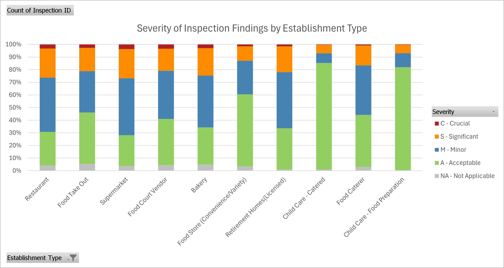
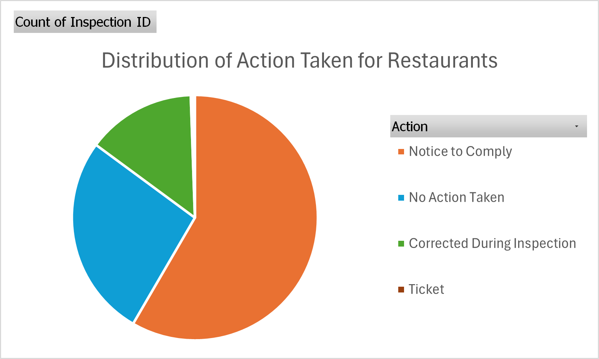
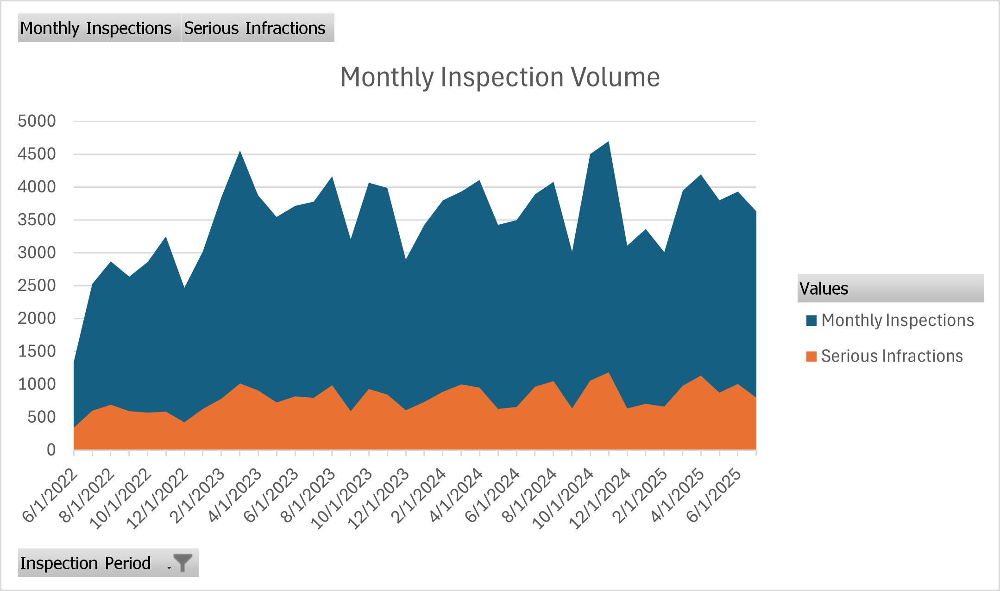

# DineSafe Toronto


DineSafe Toronto is a data science project focused on analyzing food safety inspections conducted by Toronto Public Health. We explore temporal trends, establishment characteristics, neighborhood distributions, as well as patterns in infractions, severity levels, location, and operations.

You may have seen these posters displayed near the entrance of restaurants across Toronto. Issued by Toronto Public Health, they signal results of recent food safety inspections:

| Pass Notice | Conditional Notice | Closed Notice |
|----------------------|-----------------------------|------------------------|
|  |  |  |

These notices aren't just stickers. They're data points. This project dives into the inspection records behind them to uncover trends, risks, and insights across Toronto's vibrant food landscape.

## Objectives
- Identify high-risk establishments and repeated violators
- Flag crucial and serious infractions
- Analyze trends by time, geography, and establishment type
- Let anyone browse the city on a map, look up an establishment and see its inspection history
- Estimate how likely each establishment is to have infractions at its next inspection

## Quick start

```bash
git clone https://github.com/notexploiting/dinesafe-toronto.git
cd dinesafe-toronto
python3 -m venv .venv && source .venv/bin/activate   # Windows: .venv\Scripts\activate
pip install -e ".[dev]"

python -m dinesafe run      # download the latest data, clean it, train the models, build the dashboard
python -m dinesafe serve    # open http://127.0.0.1:8000
```

`run` takes about 1.5 minutes. You can also open `dashboard/index.html` directly in a browser; it works without a server.

| Command | What it does |
|---|---|
| `python -m dinesafe download` | Fetch the current feed and the 2001-2023 archive (skipped if the City hasn't published anything new; `--force` to override, `--keep N` to keep only N snapshots) |
| `python -m dinesafe build` | Clean, engineer features, train/evaluate the models, write `data/processed/`, `reports/` and the dashboard data (`--no-eval` skips validation) |
| `python -m dinesafe run` | `download` + `build` |
| `python -m dinesafe serve` | Serve the dashboard locally |
| `python src/download_data.py` | The original script, now a wrapper around `dinesafe download` |
| `python src/compute_metrics.py` | Headline metrics into `reports/metrics.txt` |
| `pytest` | Run the test suite (no network needed) |

## Workflow
1. **Data acquisition** (`src/dinesafe/ckan.py`, `download.py`)
   - Query the CKAN API for the `dinesafe` package and pick the datastore-active resource
   - Validate the schema against the datastore's own field list *before* downloading
   - Stream the ~50 MB dump to disk with retries/timeouts, write it atomically, check the row count, record a manifest (source, time, SHA-256, rows)
   - Download the historical ZIP (2001-2023) once and extract it safely
2. **Cleaning** (`clean.py`), see [Data quality issues handled](#data-quality-issues-handled)
3. **Feature engineering** (`features.py`, `categorize.py`)
   - Inspection-level table rebuilt from infraction rows; follow-up re-inspections flagged
   - Per-inspection history features that only use the past (rates, recency-weighted rates, recent infraction types, cadence, risk tier, category, chain size)
   - Establishment category from the archive, or inferred from the name by a text classifier
4. **Modelling** (`model.py`): out-of-time validation against baselines; see [Risk model](#risk-model)
5. **Outputs**: tidy CSVs for Excel/Power BI, reports and the dashboard data bundle

## Map dashboard

`dashboard/` is a static page (plain JavaScript + [Leaflet](https://leafletjs.com/), vendored, no build step):

- **Map** of every active establishment, coloured by latest result (Pass / Conditional Pass / Closed) or by predicted risk. Establishments that share an address (food courts, malls) are grouped; clicking one lists them.
- **Search** by name, address, postal code (with or without the space), phone or DineSafe ID.
- **Filters**: latest result, category, predicted risk band, last-inspected window, crucial infraction in the last 3 years, re-inspection pending, include likely-closed establishments, list only what's visible on the map. Sort by name, risk or recency.
- **Establishment page**: address, phone, category, City risk tier, latest result, a 3-year summary, the three model estimates next to the city average, the factors driving the estimate, and the full inspection history with every infraction, its severity and category, and any prosecution outcome or fine. Older archive inspections (back to 2001) sit in a collapsible section.
- Every establishment has a shareable link (`index.html#id=...`), and the browser's back button works.

Only the map tiles (OpenStreetMap) need an internet connection; search and details work offline.

## Risk model

For every establishment, three logistic-regression models estimate the chance that its **next routine inspection** finds:

| Target | City average | Out-of-time ROC AUC | Best simple baseline |
|---|---|---|---|
| Any infraction | ~50% | 0.77 | 0.74 (own smoothed history) |
| Significant or crucial infraction | ~22% | 0.70 | 0.68 |
| Conditional Pass or Closed | ~8% | 0.73 | 0.66 |

- **Validation:** trained on inspections up to Nov 2025 and tested on the following 12 months, which the model never saw. Calibration is within about 1-2 percentage points per decile. Gradient boosting was evaluated too and did not beat logistic regression, so the simpler model was kept: its explanations are exact.
- **No leakage:** each training row is "the establishment's state after inspection *k*" paired with the outcome of the next routine inspection; `tests/test_features.py` verifies that changing future inspections cannot change past features.
- **Follow-ups excluded as targets:** re-inspections a few days after a Conditional Pass pass 98.5% of the time and would teach the model the wrong lesson.
- **Explanations:** each estimate lists the factor groups that raise or lower it (recent results, kinds of recent infractions, long-term record, history length, inspection frequency, category, chain), with the underlying facts.
- **Risk bands** compare the significant/crucial estimate with the city rate: Low < 0.75x, Average 0.75 to 1.25x, Elevated 1.25 to 2x, High >= 2x.

Full metrics, calibration tables and limitations: [`reports/model_card.md`](reports/model_card.md). These are statistical estimates, not official ratings.

## Data quality issues handled

The City migrated DineSafe to a new system in late 2025, and the dataset changed completely. The original notebooks were written for the old schema (`Establishment ID`, `Inspection ID`, `Establishment Type`, `Action`, ...), which no longer exists in the live feed. The pipeline deals with:

| Issue | Handling |
|---|---|
| ~1,350 establishments listed under **both** a legacy ID and a new ID, with their inspections duplicated | Merged on a canonical key (legacy ID if known); ~3,300 duplicate inspections removed |
| No inspection ID | Inspection = (establishment, date); status is consistent within that key |
| No establishment type any more | Linked to the historical archive via the legacy ID (65% of establishments); the rest classified from the name (88.8% accuracy on confident predictions, grouped cross-validation so chains can't leak) |
| `"None"` / `"undefined"` strings instead of empty values; addresses like `"1871 O'Connor Dr None M4A 1X1"` | Normalized; street / unit / postal code / FSA parsed; placeholder phones (`0000000000`) dropped |
| Same infraction text with different spacing/case; outcome spelled two ways | Canonicalized |
| Two deficiency coding schemes (`5C.` vs `05.`) | Mapped to one set of categories; pest-related infractions always count as *Pest control* |
| Archive CSVs for 2020-2022 have stray quotes that break parsers; 2023 uses MM/DD/YYYY | Repaired (and counted) before parsing; both date formats handled |
| Archive barely records Conditional Pass / Closed (0.4% vs 16% of rows now) | Archive statuses not used for modelling; severities are |
| ~2,100 establishments never carried into the new system | Flagged as likely closed; hidden on the map by default |

Every build writes what it found and fixed to [`reports/data_quality.json`](reports/data_quality.json). If the City changes the schema again, `download` stops with a clear error instead of producing a broken dataset.

## Excel \& Power BI Dashboards
In addition to Python-based data cleaning and feature engineering, this project delivers stakeholder-ready reporting using Excel and Power BI. The `data/processed/*.csv` tables are designed to import directly (read `est_key` as text).

### Excel Dashboard
- KPIs: Total inspections, Serious infraction rate
- Monthly trend of inspections and violations
- Establishment segmentation by type and severity
- Enforcement outcomes (fines and actions)

<p align="center">
  
</p>

<p align="center">
  
</p>

<p align="center">
  
</p>

Download a demo workbook:
[**DineSafe_Dashboard.xlsx**](reports/DineSafe_Dashboard.xlsx)

> Note: This workbook contains a reduced sample (~500–1000 rows) for GitHub demo purposes, built from the pre-2025 schema.
> The full dataset is publicly available from the [City of Toronto Open Data Portal](https://open.toronto.ca/dataset/dinesafe/); `python -m dinesafe download` grabs the latest version.

### Power BI Dashboard
- Interactive map of infractions by severity
- Filters for year, establishment type, and severity
- Tree map of inspections by establishment type

## Repository Structure
```
src/
  dinesafe/                  # the pipeline package (python -m dinesafe ...)
    ckan.py                  #   CKAN API client: retries, timeouts, atomic streaming downloads
    download.py              #   resource selection, schema/row-count checks, manifests, archive ZIP
    clean.py                 #   cleaning + tidy establishments / inspections / infractions tables
    categorize.py            #   establishment categories (archive types + name classifier)
    features.py              #   leakage-free history features and training pairs
    model.py                 #   training, out-of-time evaluation, scoring, explanations
    export.py                #   compact data bundle for the dashboard
    pipeline.py              #   end-to-end build, CSV outputs, model card
    cli.py                   #   command-line interface
  download_data.py           # original entry point (wrapper)
  compute_metrics.py         # headline metrics -> reports/metrics.txt
dashboard/
  index.html, app.js, style.css
  vendor/leaflet-1.9.4/      # map library (BSD-2), vendored so no CDN is needed
  data/                      # generated: dinesafe-data.js
data/
  raw/                       # snapshots + manifests, historical/ archive (generated)
  processed/                 # establishments.csv, inspections.csv, infractions.csv (generated)
notebooks/
  01_eda.ipynb               # exploratory analysis (pre-2025 schema)
  02_feature_engineering.ipynb
notes/
  01_ckan_api_explained.md   # how the CKAN API works, and how the download was hardened
reports/
  model_card.md, model_report.json, data_quality.json   # regenerated by each build
  DineSafe_Dashboard.xlsx, excel_dashboard_screenshots/
tests/                       # pytest suite (synthetic data, no network)
```

See [`data/README.md`](data/README.md) for the columns of each processed table.

## Notebooks
`notebooks/01_eda.ipynb` and `02_feature_engineering.ipynb` document the original exploration and are rendered on GitHub ([01_eda.ipynb](https://github.com/notexploiting/dinesafe-toronto/blob/main/notebooks/01_eda.ipynb)). They expect the **pre-2025** column names, so they won't run against a fresh download. For current data, use the processed tables instead.

## Data Source

- Dataset: [City of Toronto DineSafe Open Data](https://open.toronto.ca/dataset/dinesafe/)
- License: [Open Government License - Toronto](https://open.toronto.ca/open-data-licence/)
- Updated: daily by the City; fetched with the CKAN API
